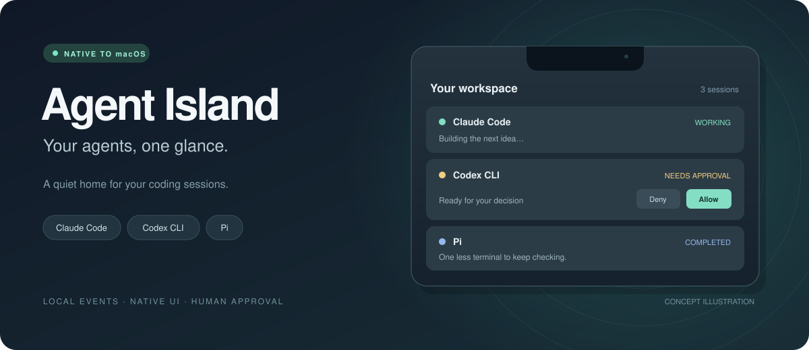
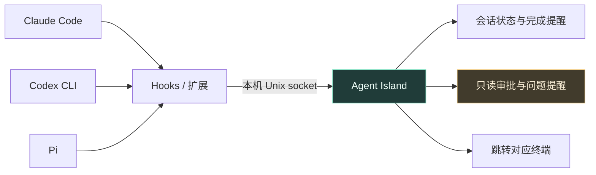

<p align="center">
  
  
  
  
</p>

# AgentIsland

macOS 原生 AI 编程助手任务面板。支持 Claude Code、Codex CLI 和 Pi，使用 SwiftUI + AppKit；通过本机 Unix socket 被动接收运行状态。

在菜单栏、屏幕顶部刘海或自由浮条中集中查看多个编程会话、接收提醒，并跳转回对应终端。面板仅用于观测，审批和回答始终在原 Agent 中处理。应用显示名称为 **Agent Island**。

> 顶部横幅为概念示意图；实际界面可通过下方的 `--demo` 模式体验。

| ◒ 一眼掌握进度 | ◇ 被动状态提醒 | ↗ 回到工作现场 |
| :--- | :--- | :--- |
| 集中查看多个会话的运行、等待与完成状态 | 显示 Agent 的审批与问题提示，不介入执行 | 跳转到对应终端，继续处理会话 |

[开始使用](#获取源码) · [连接 Agent](#连接-agent) · [工作原理](#工作原理) · [当前边界](#当前边界)

## 工作原理



事件在本机单向上报；hook 不等待面板响应，不回传允许、拒绝或回答。

## 获取源码

```sh
git clone https://github.com/NotchL1118/AgentIsland.git
cd AgentIsland
```

## 构建与运行

要求 macOS 14+、Xcode/Command Line Tools（Swift 5.9+）。无需 Python，也无需安装 Swift 第三方依赖。

```sh
zsh scripts/build-app.sh
open 'dist/Agent Island.app'
```

应用可以随意移动或更新：Agent 配置里只写一个固定的转发入口，应用每次启动时会把它指向自己的新位置，无需重新安装接入。

点击菜单栏图标展开/收起，右键打开设置或切换显示方式。默认不会申请通知权限，设置中可按需启用。

- **顶部刘海**：贴合屏幕顶部，为摄像头留出空白；鼠标移入展开。
- **自由浮条**：鼠标移入展开；1～3 个 Agent 平铺显示各自图标、项目名和状态点，更多时只显示图标，放不下时用「+N」查看其余会话；没有 Agent 时才显示「Agent Island」。拖动浮条任意区域移动，单击 Agent 查看对应任务，右侧箭头展开/收起。双击整条浮条（包括图标、文字和箭头）回到所在屏幕顶部中央并记住位置；快捷设置也可归位。靠近边缘展开时会避让。
- **仅菜单栏**：只显示状态图标，不显示任务内容或数量。有 Agent 运行时显示轻微的波形动画，任务全部成功结束后切换为完成勾号；等待处理、异常和断开分别显示叹号、叉号和问号。多个会话优先显示运行，其次是待处理、异常、断开和已完成；状态随保留的会话记录更新，清空记录后恢复空闲。开启系统“减少动态效果”时，运行状态使用静态省略号。点击图标展开任务面板，点击外部收起。后台事件不会自动弹出面板，点击完成通知仍可打开对应会话。

三种形态均在点击外部后自动收回；顶部刘海和自由浮条也会在鼠标移出后收回，不受展开方式或键盘焦点影响。自动收回默认等待 0.3 秒，可在设置的“自动收回延迟”中调整为立即至 2 秒。等待期间移回面板会取消鼠标移出的收回，外部点击的收回仍会执行。拖动浮条时暂停自动收回；手动点击收起按钮和 Esc 仍立即响应。

会话卡片直接展示完整任务标题、摘要、待处理提示和工作目录，长内容随列表滚动。点击卡片右侧的垃圾桶可删除单条面板记录；顶部“清空已完成”可一次移除所有已完成记录，没有已完成记录时按钮置灰。运行中、待处理、异常及已断开的记录会保留。清理记录不会影响原 Agent，后续新事件仍可让会话重新出现。

浮窗中的齿轮只显示快捷设置：任务完成自动展开、显示方式、位置重置、收回延迟和通知。“Agent 接入与更多设置…”打开独立设置窗口，分为“通用”和“Agent 接入”，可调整开机启动、安装或移除接入、复制启动命令、查看操作结果；菜单栏图标右键也可打开。该窗口可移动、缩放，鼠标移出不会关闭；打开期间后台任务不会自动展开浮窗打断设置。

体验原生演示（不连接真实 Agent、不安装 hooks）：

```sh
open -n 'dist/Agent Island.app' --args --demo
```

## 连接 Agent

在设置的“Agent 接入”中点击“安装接入”才会改动对应配置；之后照常直接使用 `claude` 或打开 Codex Desktop，不需要任何启动前缀。

| Agent | 监控与完成 | 需用户处理时 |
| --- | --- | --- |
| Claude Code | 支持官方 hooks | 只读显示审批、AskUserQuestion 与计划模式提醒，回 Claude 处理 |
| Codex Desktop / CLI | 支持官方 hooks | 只读显示 PermissionRequest，回 Codex 处理 |
| Pi 1.3+ | 扩展接入（按会话加载） | 显示扩展问题提醒，回 Pi 处理；不额外拦截工具 |

- **Claude Code**：安装后重启 Claude Code。
- **Codex**：Desktop 与 CLI 共用 `~/.codex/hooks.json`。安装后在 Codex 的 hooks 设置（CLI 为 `/hooks`）中检查并信任新定义，设置页会显示已信任的数量。不会绕过 Codex 的信任设置。
- **Pi**：设置中复制启动命令，使用 `pi -e /绝对路径/pi-extension.ts` 加载扩展，不改任何配置。

### 对 Agent 零侵入、卸载干净

- **仅被动观测**：支持异步的 hook 均以 `async: true` 注册；Codex 的 `SessionEnd` 按上游限制保留短时同步入口。hook 仅尝试非阻塞写入，不读取面板回复；面板离线、卡住或缓冲区满时直接丢弃观测。正常 hook 仍有进程启动与载荷解析开销，但不会等待用户操作。
- **旧配置兼容**：旧 `--wait` 已失效，升级后的运行时不会进入审批等待。在设置中更新接入可将旧同步注册改为异步；Codex 按自身要求重新信任变更后的 hook 定义。Pi 的旧 `--island-approve-tools` 参数保留为无操作兼容。
- **删掉应用也安全**：配置里的命令只调用一个固定转发入口，并先检查它是否存在；应用被移动、删除，或转发入口被清理时，hook 一律静默以 0 退出，不会阻断 Agent。
- **卸载即还原**：每次写入都记账。移除时只删带 Agent Island 标记的条目；若配置自安装后未被改动，按字节还原原文件；原本不存在的文件会被删除；Codex 会同步删掉对应的信任记录，并重排之后用户 hook 的信任序号。卸载后会复查，确认没有残留。
- **完全卸载**：设置页“完全卸载…”会清理所有记录过的位置、扫描到的残留（包括自定义的 `~/.claude-*` 配置目录），并删除 `~/Library/Application Support/AgentIsland`。之后直接删除应用即可。

也可在终端使用应用内置的同一套工具：

```sh
H='/Applications/Agent Island.app/Contents/Helpers/agent-island-hook'
"$H" status                         # 查看接入、信任与残留
"$H" install claude                 # 或 codex；--config <path> 指定其他配置文件
"$H" uninstall codex
"$H" uninstall-all                  # 完全卸载
```

详细说明：[接入说明](Integrations/README.md)。

## 已实现

- 原生菜单栏与刘海/浮条面板，多会话列表、状态与结果摘要。
- 最大 1040pt 宽的会话面板，独立卡片分隔，按项目、任务、状态分层展示，只读提醒与终端跳转；轮廓从刘海中心液态展开，文字保持原尺寸，连续开合保留动画速度。
- 透明区域鼠标穿透，收起时结束输入焦点；遵循 macOS 的“减少动态效果”设置。
- 本地事件接收、会话/轮次分离、重复和过期事件处理、多个待处理请求。
- 审批与问题仅展示详情，不提供允许、拒绝或发送回答的操作；后续工具活动与轮次事件自动更新状态。
- 完成通知与开机启动（按需开启）、待处理状态提示。
- Terminal 与 iTerm2 通过 TTY 精确定位，其他已识别终端激活应用。
- 应用退出或无响应时不影响 Agent；hook 上报不等待面板消费。

## 当前边界

- Codex Desktop 通过官方 hooks 接入，点击会话会打开 Codex，但不能直接定位到具体对话；Desktop 下各类 hook 的覆盖范围仍需实际使用验证。没有远程 SSH、额度统计、手机推送、子 Agent 分组或 tmux 精确分屏。
- 会话状态保存在内存中，重启后由新的 Agent 事件重新发现；不会扫描你的历史聊天。观测事件可能丢失，面板状态不作为 Agent 执行依据。
- 跨轮次隔离依赖上游提供可靠轮次 ID。旧版 Claude 未提供 `prompt_id` 时按事件时序降级，不伪造轮次身份。
- Terminal/iTerm2 精确跳转可能触发 macOS“自动化”授权；拒绝后降级到激活应用。未提供应用身份时明确提示手动返回。
- 应用目前是本机构建、临时签名，尚未做 Developer ID 签名、公证或自动更新。
- 已通过合成 hook、真实本地 Socket 及 Pi 扩展加载验证；真实模型回合仍需启用接入后实际使用验证。没有为测试启动付费推理。

## 验证

```sh
swift test
node --experimental-strip-types Tests/BridgeTests/pi-extension.test.mjs
```

测试仅使用合成事件、临时配置和隔离 Socket。覆盖乱序、旧轮次、只读提醒、进度恢复、完成通知去重，以及不响应/离线情况下的非阻塞上报。

## 源码布局

```text
Sources/IslandCore/       事件协议、会话模型、状态引擎
Sources/AgentIsland/      原生界面、窗口、Socket、导航与接入设置
Sources/IslandIntegrations/ Agent 适配器、hook 运行时、安装与卸载引擎
Sources/AgentIslandHook/  agent-island-hook（打包在 Contents/Helpers）
Integrations/             Pi 扩展（按会话加载）
Tests/                    状态、适配器、安装卸载、应用通信验证
Resources/Info.plist       macOS 应用信息
scripts/build-app.sh       构建与本机打包
```

新增 Agent 时，在 `Sources/IslandIntegrations` 中实现一个 `AgentAdapter`（声明要注册的 hook 和配置位置，实现只读事件映射），再加入 `AdapterRegistry`。界面、安装、记账、卸载与残留扫描都由它的描述自动生成，`provider` 也是开放字符串，主界面无需改动。协议见 [PROTOCOL.md](PROTOCOL.md)。
