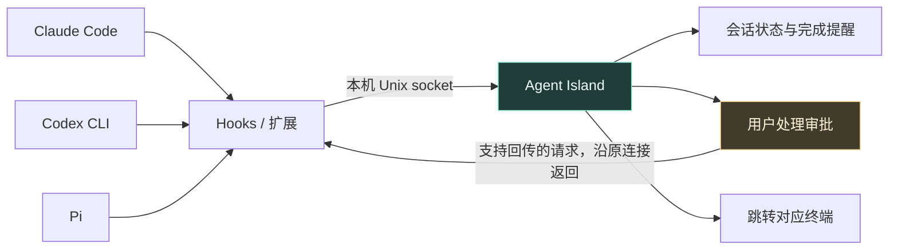

<p align="center">
  
  
  
  
</p>

# AgentIsland

macOS 原生 AI 编程助手任务面板。支持 Claude Code、Codex CLI 和 Pi，使用 SwiftUI + AppKit；运行状态与审批通过本机 Unix socket 传递。

在菜单栏、屏幕顶部刘海或自由浮条中集中查看多个编程会话，处理支持的审批请求，并跳转回对应终端。应用显示名称为 **Agent Island**。

> 顶部横幅为概念示意图；实际界面可通过下方的 `--demo` 模式体验。

| ◒ 一眼掌握进度 | ◇ 在面板中审批 | ↗ 回到工作现场 |
| :--- | :--- | :--- |
| 集中查看多个会话的运行、等待与完成状态 | 支持的请求可直接允许或拒绝，明确操作后才回传 | 跳转到对应终端，继续处理会话 |

[开始使用](#获取源码) · [连接 Agent](#连接-agent) · [工作原理](#工作原理) · [当前边界](#当前边界)

## 工作原理



事件在本机传递；不同 Agent 的审批和问答支持范围见下方接入表。

## 获取源码

```sh
git clone https://github.com/NotchL1118/AgentIsland.git
cd AgentIsland
```

## 构建与运行

要求 macOS 14+、Xcode/Command Line Tools（Swift 5.9+）。无需 Python，也无需安装 Swift 第三方依赖。

```sh
zsh scripts/build-app.sh
open 'dist/Agent Island.app'
```

应用可以随意移动或更新：Agent 配置里只写一个固定的转发入口，应用每次启动时会把它指向自己的新位置，无需重新安装接入。

点击菜单栏图标展开/收起，右键打开设置或切换显示方式。默认不会申请通知权限，设置中可按需启用。

- **顶部刘海**：贴合屏幕顶部，为摄像头留出空白；鼠标移入展开。
- **自由浮条**：鼠标移入展开；拖动名称区域移动，点击名称或右侧箭头展开/收起；自动记住显示器和位置，靠近边缘展开时会避让。快捷设置中可重置位置。
- **仅菜单栏**：平时只显示菜单栏图标，待处理任务显示数量；点击图标展开任务面板，点击外部收起。后台事件不会自动弹出面板，点击完成通知仍可打开对应会话。

三种形态均在点击外部后自动收回；顶部刘海和自由浮条也会在鼠标移出后收回，不受展开方式或键盘焦点影响。自动收回默认等待 0.3 秒，可在设置的“自动收回延迟”中调整为立即至 2 秒。等待期间移回面板会取消鼠标移出的收回，外部点击的收回仍会执行。拖动浮条时暂停自动收回；手动点击收起按钮和 Esc 仍立即响应。

浮窗中的齿轮只显示快捷设置：任务完成自动展开、显示方式、位置重置、收回延迟和通知。“Agent 接入与更多设置…”打开独立设置窗口，分为“通用”和“Agent 接入”，可调整开机启动、安装或移除接入、复制启动命令、查看操作结果；菜单栏图标右键也可打开。该窗口可移动、缩放，鼠标移出不会关闭；打开期间后台任务不会自动展开浮窗打断设置。

体验原生演示（不连接真实 Agent、不安装 hooks）：

```sh
open -n 'dist/Agent Island.app' --args --demo
```

## 连接 Agent

在设置的“Agent 接入”中点击“安装接入”才会改动对应配置；之后照常直接使用 `claude` 或打开 Codex Desktop，不需要任何启动前缀。

| Agent | 监控与完成 | 面板审批 | 面板问答 |
| --- | --- | --- | --- |
| Claude Code | 支持 | 支持单次允许/拒绝 | AskUserQuestion 单选、自定义文本；多选和计划模式回终端 |
| Codex Desktop / CLI | 支持官方 hooks | 支持 PermissionRequest | 回 Codex 处理 |
| Pi 1.3+ | 扩展接入（按会话加载） | 可选，需 `--island-approve-tools` | 显示待回答，回 Pi 处理 |

- **Claude Code**：安装后重启 Claude Code。
- **Codex**：Desktop 与 CLI 共用 `~/.codex/hooks.json`。安装后在 Codex 的 hooks 设置（CLI 为 `/hooks`）中检查并信任新定义，设置页会显示已信任的数量。不会绕过 Codex 的信任设置。
- **Pi**：设置中复制启动命令，使用 `pi -e /绝对路径/pi-extension.ts` 加载扩展，不改任何配置。

### 对 Agent 零侵入、卸载干净

- **不拖慢 Agent**：状态类 hook 以异步方式注册，不在 Agent 主循环里等待；只有审批与问答这类必须等结果的 hook 才同步。面板未运行时 hook 在几毫秒内退出。
- **删掉应用也安全**：配置里的命令只调用一个固定转发入口，并先检查它是否存在；应用被移动、删除，或转发入口被清理时，hook 一律静默以 0 退出，不会阻断 Agent。
- **卸载即还原**：每次写入都记账。移除时只删带 Agent Island 标记的条目；若配置自安装后未被改动，按字节还原原文件；原本不存在的文件会被删除；Codex 会同步删掉对应的信任记录，并重排之后用户 hook 的信任序号。卸载后会复查，确认没有残留。
- **完全卸载**：设置页“完全卸载…”会清理所有记录过的位置、扫描到的残留（包括自定义的 `~/.claude-*` 配置目录），并删除 `~/Library/Application Support/AgentIsland`。之后直接删除应用即可。

也可在终端使用应用内置的同一套工具：

```sh
H='/Applications/Agent Island.app/Contents/Helpers/agent-island-hook'
"$H" status                         # 查看接入、信任与残留
"$H" install claude                 # 或 codex；--config <path> 指定其他配置文件
"$H" uninstall codex
"$H" uninstall-all                  # 完全卸载
```

详细说明：[接入说明](Integrations/README.md)。

## 已实现

- 原生菜单栏与刘海/浮条面板，多会话列表、状态与结果摘要。
- 最大 800pt 宽的横向会话列表，行内审批与终端跳转；轮廓从刘海中心液态展开，文字保持原尺寸，连续开合保留动画速度。
- 透明区域鼠标穿透，收起时结束输入焦点；遵循 macOS 的“减少动态效果”设置。
- 本地事件接收、会话/轮次分离、重复和过期事件处理、多个待处理请求。
- 审批/回答沿原连接回传，仅明确点击后发送；断连和超时撤销卡片，回到 Agent 自身流程。
- 完成通知与开机启动（按需开启）、无回传能力的待处理状态提示。
- Terminal 与 iTerm2 通过 TTY 精确定位，其他已识别终端激活应用。
- 应用退出释放所有等待中的请求，普通状态 hook 在面板不运行时迅速返回。

## 当前边界

- Codex Desktop 通过官方 hooks 接入，点击会话会打开 Codex，但不能直接定位到具体对话；Desktop 下各类 hook 的覆盖范围仍需实际使用验证。没有远程 SSH、额度统计、手机推送、子 Agent 分组或 tmux 精确分屏。
- 会话状态保存在内存中，重启后由新的 Agent 事件重新发现；不会扫描你的历史聊天。正在等待的审批回到原 Agent，不伪装恢复失效的回传连接。
- 跨轮次隔离依赖上游提供可靠轮次 ID。旧版 Claude 未提供 `prompt_id` 时按事件时序降级，不伪造轮次身份。
- Terminal/iTerm2 精确跳转可能触发 macOS“自动化”授权；拒绝后降级到激活应用。未提供应用身份时明确提示手动返回。
- 应用目前是本机构建、临时签名，尚未做 Developer ID 签名、公证或自动更新。
- 已通过合成 hook、真实本地 Socket 及 Pi 扩展加载验证；真实模型回合仍需启用接入后实际使用验证。没有为测试启动付费推理。

## 验证

```sh
swift test
node --experimental-strip-types Tests/BridgeTests/pi-extension.test.mjs
```

测试仅使用合成事件、临时配置和隔离 Socket。核心测试覆盖乱序、旧轮次、审批排队、取消、断连及完成通知去重。

## 源码布局

```text
Sources/IslandCore/       事件协议、会话模型、状态引擎
Sources/AgentIsland/      原生界面、窗口、Socket、导航与接入设置
Sources/IslandIntegrations/ Agent 适配器、hook 运行时、安装与卸载引擎
Sources/AgentIslandHook/  agent-island-hook（打包在 Contents/Helpers）
Integrations/             Pi 扩展（按会话加载）
Tests/                    状态、适配器、安装卸载、应用通信验证
Resources/Info.plist       macOS 应用信息
scripts/build-app.sh       构建与本机打包
```

新增 Agent 时，在 `Sources/IslandIntegrations` 中实现一个 `AgentAdapter`（声明能力、要注册的 hook 和配置位置，实现事件映射与回写），再加入 `AdapterRegistry`。界面、安装、记账、卸载与残留扫描都由它的描述自动生成，`provider` 也是开放字符串，主界面无需改动。协议见 [PROTOCOL.md](PROTOCOL.md)。
